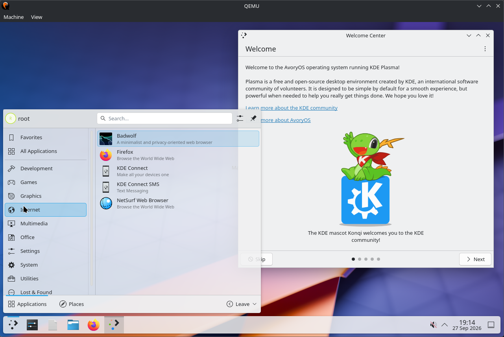
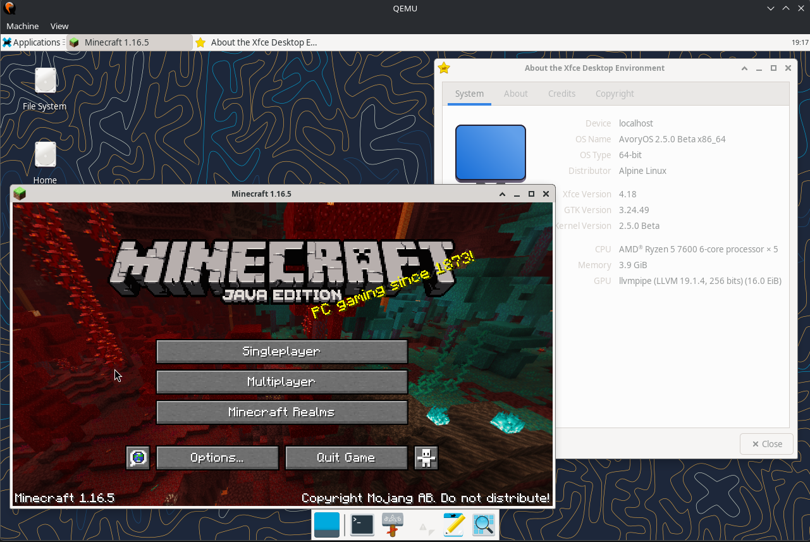

# AvoryOS

AvoryOS is an open-source hobby operating system for x86_64 PCs. It includes a monolithic kernel, a Linux-compatible system call interface, POSIX-oriented userland, networking, and a graphical desktop environment.




## Features

- x86_64 kernel with SMP scheduling, virtual memory, and a virtual filesystem
- Storage support for NVMe, AHCI, IDE, and ramdisk devices
- IPv4 and IPv6 networking
- Graphics support through VirtIO-GPU and a LinuxKPI layer for Linux DRM drivers
- Userland based on glibc and an Arch package root filesystem
- Desktop sessions including KDE Plasma, XFCE, IceWM, and Weston

AMDGPU and NVIDIA support is under active development. For stable graphics in QEMU, use the default make run target.

## Boot speed and diagnostics

The default and minimal images boot their first Limine entry immediately
(`timeout: 0`). Hold a key during boot to access the menu, or set `timeout: 3`
in `limine.conf` / `limine-minimal.conf` before rebuilding for a visible countdown.

Kernel boot stress tests and benchmarks are opt-in. Add `boot_selftest=1` to
the kernel command line to run the early memory/CPU tests and LinuxKPI suites
at their usual initialization stages. For example:

```sh
make KERNEL_CMDLINE='init=/sbin/init boot_selftest=1 screenlog'
```

Boot-memory reclamation checks large mappings against reclaimable memory ranges,
rather than scanning the memory map again for every 4 KiB page. Active mappings
keep the same page protections.

SATA/AHCI uses direct DMA for word-aligned kernel heap buffers. Startup logs
report total AHCI and per-disk setup times; engine and IDENTIFY waits are
bounded, and absent legacy ATA devices exit probing immediately.

Normal boots still initialize all devices and drivers. Individual diagnostic
options such as `vfs_selftest=1`, `fb_bench=1`, and `rcu_bench=1` remain available.

## Build

On a Linux host, install the usual build tools and utilities, including Make, a C compiler, NASM, Git, Python 3, `xorriso`, QEMU, and the ext4 and partitioning utilities (`e2fsprogs`, `parted` or `util-linux`).

Bootstrap required dependencies and toolchains:

```sh
./bootstrap.sh
```

Build the kernel and the default bootable images:

```sh
make
```

The default target builds the kernel, ISO, GPT disk image, and OVMF firmware. To run the system in QEMU:

Each kernel source state gets a generated build tag, shown in the boot message and `uname -v`. Rebuilding without kernel or LinuxKPI source changes keeps the same tag; changing those sources generates a new one.

```sh
make run
```

`make run` uses KVM. To run with QEMU's software emulation instead:

```sh
make run-tcg
```

For a smaller image, build and run the minimal profile:

```sh
make minimal-iso
make run-minimal
```

## Project layout

- `kernel/` — kernel source and LinuxKPI compatibility code
- `userland/` — userland programs and utilities
- `initrd/` — early boot configuration and services
- `scripts/` — build and setup scripts
- `docs/` — project documentation
- `assets/` — images and other project assets

## License

See [LICENSE](LICENSE).
