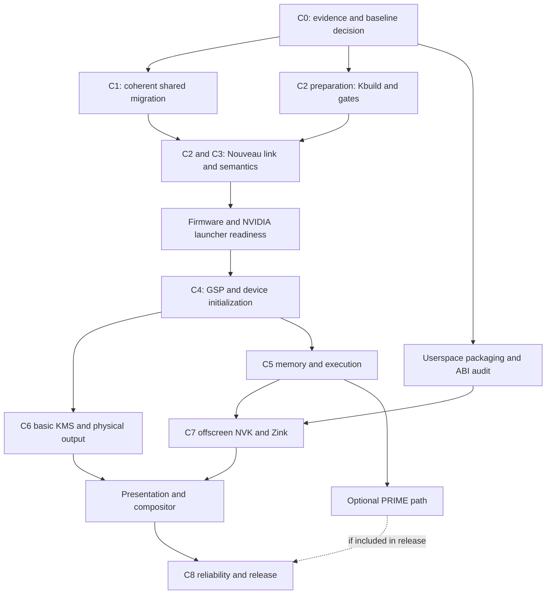

# Nouveau through LinuxKPI: RTX 4060 Ti implementation plan

Written 2026-10-18 against AvoryOS commit `883a44c`.
Status: C0 delivered; C1 source migration is integrated with build/boot evidence.
Physical AMD desktop/games smoke test is user-reported passing. C2 is complete.
C4 now initializes AD106 GSP and registers Nouveau DRM in an isolated
6.18.42 / 570.144 candidate; explicit upstream removal also completes.
The 32-case native missing-firmware software matrix passes. Physical
failed-probe resource cleanup and full-firmware recovery are still pending.
GPU-only PCIe assignment now survives shutdown, active-GSP QEMU close and
relaunch; two strict hardware boots also pass the corrected page-count test.
SMP readiness and AMD validation remain open.
See the [C4 hardware report](nouveau/c4-bringup.md).
C5 core is closed (2026-10-21): hardware GEM/VM checks, real copy-engine EXEC
with byte/canary verification and binary/timeline fences pass, and the
intermittent VKMS warm-loop PMM drift is root-caused, fixed without relaxing
the check and verified by eight consecutive strict software boots; see the
[C5 report](nouveau/c5-memory-execution.md) for the evidence chain and the
deferred-gates scope decision. Pressure and outstanding-work gates are
deferred known gaps; hardware re-validation of the fixed allocator is pending.
C3 compile/link and targeted software checks are complete; see the
[C3 report](nouveau/c3-compatibility.md) for validation and open runtime limits.
See the [C1 migration report](nouveau/c1-migration.md) for results and limits.
See [C0 results and selected inputs](nouveau/baseline-audit.md). No active driver
import, kernel/configuration change, or hardware binding was performed in C0.

Revision 2 expands the original milestone outline into an execution backlog,
subsystem contracts, hardware sessions, failure analysis and release gates.
The C0 evidence record covers the initial audit tasks; later implementation and
hardware-validation tasks remain pending.

Navigation:

- [Architecture and baseline decision](#architecture-and-baseline-decision)
- [Milestone outline C0–C8](#ordered-implementation-chunks)
- [Delivery levels and dependency graph](#delivery-levels-and-dependency-graph)
- [Detailed execution backlog N00–N61](#detailed-execution-backlog)
- [Subsystem contracts](#subsystem-contract-checklist)
- [Hardware sessions H0–H5](#hardware-session-playbooks)
- [Failure diagnosis and gates G0–G5](#failure-diagnosis-and-decision-gates)
- [Tests and evidence](#test-tiers-and-reusable-repository-tests)
- [Change boundaries, rollback and time planning](#change-boundaries-rollback-and-time-planning)

## Goal and first target

Run upstream Nouveau through AvoryOS LinuxKPI on the user's desktop RTX 4060 Ti:
PCI discovery → GSP firmware boot → memory/VM and command submission → KMS →
Mesa NVK/Zink acceleration → reliable process teardown and repeated boots.

Read-only host inventory identifies:

| Function | BDF | PCI ID | Role |
|---|---|---|---|
| NVIDIA AD106 / RTX 4060 Ti | `0000:01:00.0` | `10de:2803` | First Nouveau target; currently host display GPU |
| NVIDIA HDMI/DP audio | `0000:01:00.1` | `10de:22bd` | Account for IOMMU grouping; audio support is a later feature |
| AMD Raphael iGPU | `0000:0e:00.0` | `1002:164e` | User intends to move host display here during NVIDIA tests |

The first release supports this exact board and validated connector modes.
It does not imply support for every NVIDIA generation. Defer laptop Optimus,
Tegra, SVM/HMM, system suspend, runtime D3, video acceleration, HDR/VRR, MST,
manual overclocking, and HDMI audio until the basic path passes. Preserve
firmware-managed cooling and essential thermal protection during all tests.

## Architecture and baseline decision

Reuse the existing architecture:

```text
AvoryOS applications / compositor
    Mesa NVK (Vulkan) + Zink (OpenGL), EGL/GBM, libdrm
    native DRM file/ioctl/mmap/poll bridge
    upstream DRM / TTM / scheduler / Nouveau DRM + NVIF + NVKM
    LinuxKPI APIs and native PCI / IRQ / DMA / memory / VFS bridges
    RTX 4060 Ti, with matching NVIDIA GSP firmware
```

The initial 2026-10-18 audit used **v6.6.156**, commit
`8b73de7da85fde281a385e0b26eda9bffd3ca477`. The active import is now
v6.12.113 (`7fdb7c1824a1f9979d648d7ae28ac446bcee9c6e`); the isolated
v6.18.42 candidate uses `856a9b51680cbbed1ace1207b29e424a616cff48`.
The following baseline analysis and gap table record the initial audit.
It has Nouveau VM_INIT/VM_BIND/EXEC UAPI headers and source in the clone cache,
but Nouveau is not copied into `kernel/linux/` or selected for compilation.
Its GSP subdirectory contains early Falcon support, not the Ada GSP-RM path.
Thus “NVK requires Linux 6.6” is insufficient to establish support for this GPU.

**Recommended approach:** evaluate an exact 6.12 LTS stable tag as the first
candidate, then migrate the shared imported graphics stack coherently before
bringing up Ada. Upstream v6.12 contains the Ada GSP-RM implementation. The
exact stable tag, commit, firmware revision and Mesa/libdrm versions must be
recorded in C0; 6.12 is a candidate, not a compatibility result or a claim that
it is the newest release. If the selected userspace needs newer interfaces,
choose a newer coherent baseline after measuring the migration cost.

Do not link a newer Nouveau against arbitrarily mixed 6.6 DRM/TTM/scheduler
internals. A Nouveau-only backport would need an explicit dependency closure
and maintained patches; it is an alternative project decision if migration
proves impractical. Do not pursue it silently as a shortcut.

Mesa's current documented path for Turing and newer is NVK plus Zink for
OpenGL. Include Vulkan and OpenGL in the target; do not assume enabling the
legacy Gallium Nouveau driver will accelerate this Ada card.

## Current reuse and concrete gaps to investigate

These findings come from current source, rather than historical completion claims.
Compile/link and runtime audits still decide whether each API is sufficient.

| Area | Existing implementation | Required work / evidence |
|---|---|---|
| Import | `scripts/linux-import.sh`, `scripts/linux/subset.txt`, `scripts/linux/files.txt` | Pin the new baseline; import Nouveau and its private headers and shared dependencies. Revalidate existing AMD patches against it. |
| Kbuild | `scripts/linux/kbuild-subset.py` | Currently evaluates AMD/display roots and gates their combined output on `KPI_AMDGPU`. Add Nouveau's **Kbuild** root, nested NVIF/NVKM includes, per-driver flags, independent gates and shared-helper ownership. |
| Driver binding | `kernel/linuxkpi/src/pci.c` | AMD gate defaults on. Add independent default-off Nouveau gate and explicit target BDF selection; leave other devices available to their owners. |
| Parameters | `kernel/linuxkpi/include/linux/moduleparam.h`, `kernel/linuxkpi/src/params.c` | Current macro stores unqualified names. Audit module namespacing and collisions such as `config`, `debug`, `modeset`, and `runpm` before documenting `nouveau.*` options. |
| Firmware | `kernel/linuxkpi/src/firmware.c`, firmware installer/manifests | Loader caps individual blobs at 16 MiB and allocates with `kmalloc`. Measure matching GSP blobs; support their sizes with appropriate allocation, bounds and cleanup. Audit compressed-blob handling. |
| VM/submission | Existing TTM, scheduler, dma-fence/resv, syncobj | Import and validate the chosen baseline's GPUVA/GPUVM helpers and Nouveau VM_BIND/EXEC paths; do not conflate VM_BIND with optional SVM/HMM. |
| DMA/PCI/IRQ | Native bridges and LinuxKPI implementations | Verify SG addresses, DMA masks, coherent memory, cache attributes, MMIO ordering, BARs, interrupt routing and synchronization for AD106. Audit identity-DMA assumptions. |
| Ancillary APIs | Existing partial I2C, hwmon/backlight, PCI/PM compatibility | Census Nouveau usage, including VGA arbitration, switcheroo, power-supply, firmware parser and GSP RPC dependencies. Inactive optional APIs may fail explicitly; active functionality needs real semantics. |
| Userspace ABI | DRM file bridge and imported ioctl core | Validate NVIF, GEM, mmap, events, syncobj timelines, VM_BIND/EXEC and PRIME end to end using the exact Mesa/libdrm builds. |
| Desktop selection | `initrd/drm-pick.sh`, `initrd/avory-drm.sh` | Selection currently prefers AMD and includes a fixed `card2`/`renderD129` fallback. Select by driver/device/connectors and pair render/display nodes without fixed minor assumptions. |
| Hardware launcher | `GNUmakefile`, `scripts/vfio-*.sh`, existing GPU capture scripts | AMD defaults include Raphael BDF and VBIOS. Create a separate NVIDIA profile, ROM handling and logs; do not reuse AMD reset/suspend machinery without an audit. |

Keep upstream changes reproducible. The import script currently applies tracked
patches from `scripts/linux/patches/`, despite the older documentation describing
an entirely unmodified import. Reconcile that policy in C0: prefer generic
overlays/native bridges; explicitly document any necessary tracked source patch.
Never make ad hoc edits inside generated, gitignored `kernel/linux/`.

## Ordered implementation chunks

The chunks below describe major milestones. The detailed work packages later in
this document define the execution order. C0 precedes the shared migration;
build-tool preparation and userspace preparation can then proceed independently.
After C4, basic display and render submission are separate branches. Offscreen
NVK validation does not wait for physical scanout or PRIME. C8 joins the validated
paths into a supported configuration. Hardware probing waits for C3.

### C0 — freeze the support contract and audit dependencies

**Audit delivered:** [baseline audit](nouveau/baseline-audit.md),
[version lock](nouveau/c0-lock.json), and
[dependency ledger](nouveau/dependency-ledger.csv). Selected Linux v6.12.113,
GSP-RM 535.113.01 and Mesa 26.2.5 for implementation. Seven targeted host test
programs pass; software boot evidence includes unresolved baseline failures.
Source selection does not mean the migration or physical hardware is validated.

1. Record exact AD106 board/subsystem IDs, VRAM size, VBIOS, connectors, host
   firmware settings, IOMMU groups and reset capabilities. No rebinding yet.
2. On a separate source checkout/cache, compare the candidate's Nouveau Kconfig,
   Kbuild, DRM/TTM/scheduler interfaces, GSP firmware requests and UAPI with the
   existing baseline. Inventory matching Mesa/libdrm and toolchain requirements,
   including NVK's Rust/NAK build dependencies when building from source.
3. Inventory existing upstream patches and version-sensitive AMD overlays.
   Capture a baseline of relevant existing regressions; distinguish known AMD
   failures from regressions introduced by the migration.
4. Write a dependency ledger: caller, API, current behavior, required semantics,
   active on AD106 or compile-only, implementation owner, and validation.
5. Record the exact selected Linux commit, userspace versions, firmware files,
   hashes/licenses and scope. Retain the old boot artifacts for comparison.

Exit: one coherent baseline and reproducible inputs selected; no unknown
hardware identity or assumed firmware compatibility remains.

### C1 — migrate the shared graphics baseline

1. Update version resolution/pinning and imported shared dependencies; regenerate
   config/build identity. Audit changed DRM/TTM/scheduler APIs and LinuxKPI layouts.
2. Adapt existing overlays, bridges and tracked patches to the selected baseline.
   Keep Nouveau disabled while proving the shared migration.
3. Build the native-only, shared-DRM and AMD configurations. Run existing LinuxKPI
   boot suites, userland DRM/dma-buf tests, and native VirtIO desktop fixtures.
4. Validate the existing AMD hardware path separately before calling the migration
   regression-free; when Raphael hosts the display, schedule this as a separate
   hardware session rather than simultaneously assigning it to a VM.

Exit: shared migration has build/boot evidence and no new unexplained failures.
Record separately any physical AMD validation still pending.

### C2 — import Nouveau and make the build genuinely independent

Implementation/evidence: [C2 import and controls](nouveau/c2-import.md).
Complete: all selected objects link and real registration is verified with
the probe gate closed. The original compiler inventory is retained.

1. Add the complete Nouveau directory to `subset.txt`. Generate its object list
   from upstream Kbuild, including `nvif/`, `nvkm/`, and display subdirectories.
2. Refactor the generator's AMD-specific flag collection and output gate. Keep
   include paths and per-file flags scoped to their owning driver. Compile shared
   display helpers exactly once when either driver needs them.
3. Introduce `KPI_NOUVEAU ?= 0` independently of `KPI_AMDGPU`. Test all four
   combinations after import: neither, AMD only, Nouveau only, both.
4. Add only justified Kconfig symbols; absent means disabled. Start without
   Tegra, SVM/HMM, ACPI laptop integration, optional backlight or runtime PM.
   Audit Kconfig selects rather than blindly defining unsupported subsystems.
5. Add `kpi_nouveau=0` by default and a proposed `kpi_nouveau_bdf` selector.
   Prove registration while probing stays blocked. Test parameter namespace
   handling before enabling any hardware path.

Exit: deterministic source/object manifest, no unsupported Kbuild constructs,
no duplicate shared objects, existing driver gates retain their behavior.

### C3 — close compile/link gaps with semantic implementations

Implementation/evidence: [C3 compatibility report](nouveau/c3-compatibility.md).
Hardware initialization remains unverified; the known VKMS accounting failure
and inherited runtime limitations remain explicit rather than waived.

1. Compile all selected Nouveau objects; classify errors by subsystem and fix
   generic APIs in LinuxKPI or native bridges. Use the dependency ledger to track
   active paths, not just unresolved symbols.
2. Import missing upstream algorithms/helpers rather than reproducing them.
   Validate GPUVM/GPUVA, DRM execution locking, scheduler and syncobj lifetimes.
3. Add bounded behavior tests for new DMA/SG, waits, timers/workqueues, firmware,
   teardown and parameter semantics where needed. Wire meaningful new boot suites
   through `kernel/linuxkpi/src/boot_tests.c` following existing conventions.
4. Audit optional IOMMU/platform paths separately from the PCIe target. Host VFIO
   isolation and guest LinuxKPI IOMMU support are different requirements. Never
   claim an IOMMU mapping succeeded if the guest implementation cannot provide it.
5. Resolve active-path stubs. Unsupported optional operations must return the
   correct failure or remain disabled, rather than pretend success.

Exit: full compile/link, gate-off boot and targeted semantic tests pass with
both drivers built; active-path compatibility audit has no unexplained stubs.

### C4 — firmware, PCI probe and GSP boot on the RTX 4060 Ti

Started: [C4 preparation and validation](nouveau/c4-bringup.md). The bounded
large-file loader, pinned staging and dedicated launcher are implemented;
strict one-CPU firmware readiness and an ordinary eight-CPU software boot pass.
Physical GSP/DRM initialization, ordered removal and GPU-only reset reuse now
work. The physical failed-probe resource/recovery checks remain outstanding;
do not infer their completion from successful probe/teardown tests.

1. Add a dedicated NVIDIA test launcher with explicit BDF, group and ROM handling.
   Inspect existing launcher preflight and reset scripts for Radeon assumptions.
2. Before assignment, the user moves the monitor and host desktop to Raphael.
   Verify the host no longer uses NVIDIA, inspect all group members and functions,
   and provide independent serial capture. Do not invoke `run-c7-prime`, whose
   default assigns the intended host iGPU. Do not feed the AMD VFCT ROM to NVIDIA.
3. Package the exact firmware requested by the chosen source under `/lib/firmware`;
   adjust loader size/allocation behavior from measured files, with missing,
   oversized, truncated and allocation-failure coverage. Test readiness before
   driver initcalls. Do not substitute firmware from an unrelated driver revision.
4. Opt in to NVIDIA probing. Capture PCI/BAR/ROM/chipset detection, firmware
   names/sizes, GSP boot, RPC sequence/status, IRQ delivery and initialization.
   Use bounded waits and first-failure logs; a timeout must retain useful state.
5. Exercise probe failure cleanup and VM shutdown. Distinguish a fresh power-on
   from a reused device; use a cold boot when reset is not proven reliable.

Exit: GSP initializes, DRM device registers, initialization/shutdown are bounded,
and missing firmware fails without memory/IRQ leaks or a kernel hang.

### C5 — memory, VM and command execution

Started: [memory/VM and first execution results](nouveau/c5-memory-execution.md).
Core closed 2026-10-21: the first hardware memory, synchronous VM,
deterministic copy and asynchronous timeline-dependency gates pass, and the
VKMS warm-loop PMM drift release gate is root-caused, fixed in the allocator
and software-verified 8/8 strict. Pressure and outstanding-work cleanup are
deferred known gaps, recorded as untested; hardware re-validation of the
fixed allocator is pending.

1. Validate GEM creation, CPU mapping and fault behavior in system memory/VRAM;
   pressure eviction, placement, SG mappings, cache visibility and unmapping.
2. Exercise channels/NVIF objects, minimal copy or compute submission and fences.
   Check output bytes, not merely successful ioctl returns.
3. Validate VM_INIT/VM_BIND/EXEC, synchronous/asynchronous binds and syncobj
   timelines with dependency ordering, invalid ranges, sparse mappings where
   supported, allocation failures and process exit while work is outstanding.
4. Test ownership, handle isolation, zeroing and cleanup across concurrent clients.
   Unsupported SVM stays separate from working explicit GPU virtual memory.

Exit: deterministic GPU output and bounded fence progress across repeated clients;
negative UAPI cases return correct errors and resources return to baseline.
(Core exit met 2026-10-21 within the recorded scope decision; the deferred
gates above are excluded from that claim.)

### C6 — display and PRIME

Started 2026-10-21: [first physical KMS inventory](nouveau/c6-display.md)
passes strict hardware boot and cleanup checks. Four CRTCs, four connectors
and twelve planes are enumerated; explicit detection reports no connected
sink, modes or EDID. The owner selected PRIME-to-VirtIO rather than physical
NVIDIA scanout. Two-client Nouveau GART export/VirtIO import, full byte
coherence, re-export and exporter-close lifetime pass on hardware. Two
CPU-filled linear PRIME-to-VirtIO presentation frames now pass exact QMP
full-frame pixel checks, strict boot and teardown. Two copy-engine-produced
frames also pass exact captures after bounded timeline wait/query and
future-point timeout checks. Core closed 2026-10-21 for the selected linear
NVIDIA-to-native-VirtIO PRIME / legacy KMS route: six exact captured updates,
flip events and pending-event teardown pass; seven real CE EXEC jobs held on
controlled dependencies prove nonblocking implicit-fence handoff. Guest hardware
inventory/overrides/fallback pass after replacing static guessed DRM sysfs parents
with registered-minor PCI identities. See the linked C6 record for final kernel
hash, readiness, hardware evidence and explicit exclusions. This does not prove
an actively engine-busy shader workload or atomic NONBLOCK.
Physical NVIDIA scanout remains a separate untested profile, not a blocker
for developing the selected PRIME route or a silently passed gate.

1. Discover the NVIDIA card by driver/BDF; query resources, EDID, connectors and
   modes. Start with one physical monitor and a conservative supported mode.
2. Prove a dumb-buffer test pattern, page flips/events, cursor and supported KMS
   commit modes. Check actual visible pixels and repeated modesets.
3. Test PRIME export/import and synchronization against VirtIO for optional
   captured presentation. Treat direct NVIDIA scanout and VirtIO presentation
   as separate paths with separate evidence. Validate formats/modifiers explicitly.
4. Generalize desktop selection while preserving explicit user overrides and a
   working native display fallback. Do not apply AMD's emulated-sink special case
   as proof that an NVIDIA display is connected.

Selected-route exit met: linear PRIME-to-VirtIO has pixel, pending synchronization,
event, ownership/lifetime and selection/fallback evidence. Physical NVIDIA output,
atomic, other formats/reverse sharing, shaders/compositor integration and SMP
stress remain excluded. The original physical-output exit is not silently passed;
the owner selected the separately qualified PRIME route instead.

### C7 — Mesa NVK, Zink and desktop integration

1. Package the selected NVK Vulkan ICD, Zink, EGL/GBM and required libdrm pieces.
   Check installed main-rootfs Arch packages first; a Gallium package alone is not proof
   that NVK, its ICD or the required build dependencies are present.
2. Verify render-node access, capability queries and exact userspace/kernel
   interface compatibility. Test `vulkaninfo`, an offscreen render/readback,
   then presentation and an EGL/OpenGL render through Zink.
3. Require renderer/device identity and deterministic pixel checks; software
   fallback must be visible in results. Do not infer acceleration from an open
   desktop or a successful `glxinfo` invocation alone.
4. Validate Xorg modesetting/glamor or the selected Wayland compositor, then
   native presentation and any separately supported PRIME desktop path.

Exit: Vulkan and OpenGL render correctly on the RTX 4060 Ti; the chosen desktop
session opens, closes and restarts without leaked BOs/channels or stuck fences.

### C8 — reliability, recovery and supported release

1. Exercise concurrent clients, memory pressure, repeated app/compositor exits,
   interrupted waits, invalid submissions, monitor hotplug and repeated VM boots.
2. Test fault/timeout handling with isolated workloads. Either prove recovery or
   report a bounded device-lost condition and document a required cold restart.
   Do not advertise reset recovery based on successful initialization alone.
3. Run shared LinuxKPI/DRM tests, native VirtIO desktop checks and a separate AMD
   regression session. Include one-CPU and multi-CPU runs for changed primitives.
4. Complete at least 100 render-client open/submit/close cycles, 1,000 page flips,
   10 guest start/stop cycles and a two-hour mixed desktop/render soak. These are
   initial acceptance targets, not completed tests or proof of all-device support.
5. Publish supported versions, connectors/modes, firmware manifest, reproducible
   commands, logs, known limitations and hardware ownership/restore procedure.

Exit: all claimed features have hardware evidence and regressions are accounted
for; only then consider default-on probing for validated hardware.

## Validation and evidence rules

- For each chunk, record source/config hashes, exact build/boot commands, hardware
  state, expected output and serial/pixel evidence. Update `docs/linuxkpi-gaps.md`
  when adding/closing compatibility gaps and `docs/linuxkpi-progress.md` after
  executed work; this plan itself is not an implementation progress claim.
- Run targeted tests plus the repository-required LinuxKPI suites, userland
  `test_kpi_drm` / `test_kpi_dmabuf` and desktop regression for implementation
  chunks. Document unavailable hardware checks as pending, never passed.
- QEMU VirtIO/vkms fixtures test shared infrastructure. They cannot establish
  NVIDIA firmware, interrupt, memory or display correctness without real hardware.
- Keep generic fixes reusable by AMDGPU; keep NVIDIA diagnostics/quirks scoped.
  Log enough to locate the first failing stage without unbounded polling output.
- No existing test launcher is a ready-to-run NVIDIA command until its AMD-specific
  defaults, preflight, ROM and reset behavior have been replaced and verified.

## First implementation deliverable

Start with **C0 and a C1 migration report**, not GPU binding: select the exact
GSP-capable baseline and userspace pair, measure compile/API changes, and capture
existing regression evidence. Split the shared migration, Nouveau build plumbing,
semantic API fixes, hardware bring-up, display and userspace into separate changes.
Estimate remaining effort after C3's semantic gap census; compile success alone
does not give a defensible schedule for GSP and GPU memory bring-up.

## Delivery levels and dependency graph

Use these outcomes to answer “what works?” without collapsing every stage into
the word support. Passing one level does not imply the later levels pass.

| Level | User-visible outcome | Evidence required |
|---|---|---|
| L0 | Reproducible baseline and candidate builds | Version lock, four build combinations, native boot results |
| L1 | NVIDIA initializes under AvoryOS | Correct AD106 identity, GSP boot/RPC progress, bounded probe and shutdown |
| L2-D | Basic NVIDIA physical display | Real connector/mode, test pattern and page-flip event/pixel evidence |
| L2-R | GPU executes useful work | Memory round trip and deterministic copy/compute output with real fences |
| L3 | Accelerated offscreen graphics | NVK render/readback and Zink OpenGL pixels on AD106 |
| L4 | Accelerated desktop | Presentation plus one selected compositor, close/reopen tests |
| L5 | Experimental supported release | Stress, failure handling, AMD/native regressions and documented limitations |
| L6 | Daily-use candidate | Longer real workloads, stable recovery policy and expanded coverage |

L2-D and L2-R may arrive in either order. PRIME is optional until a particular
presentation profile depends on it. Choose direct NVIDIA display as the first
physical scanout profile, and use offscreen rendering to debug NVK independently.



Independent work here means separate engineering tasks, not an instruction to
spawn agents or run hardware experiments concurrently.

## Detailed execution backlog

Task identifiers are stable so implementation notes can refer to a specific
deliverable. Each task records dependencies, changed files, validation and remaining
limitations in its resulting change. Proposed new filenames and CLI options below
are design targets, not existing commands.

### WP0 — reproducible investigation and baseline selection

**N00 — create the experiment record.** Capture the AvoryOS commit, dirty-tree
state, Linux pin, overlay/config hashes, compiler versions and image identities.
Proposed output: `docs/nouveau/baseline-audit.md` and a machine-readable version
lock. Keep unrelated user work out of the experiment diff. Cache directories and
disk/image outputs must be separate from the known working artifacts.

**N01 — inventory the actual board.** Record PCI subsystem/revision IDs, VRAM
size, VBIOS identity, connected displays, BAR sizes and host driver. Capture IOMMU
group membership and available reset methods using read-only interfaces. Confirm
which monitor/input connections will remain usable when NVIDIA belongs to the VM.
Do not assume that the audio function is the only other group member.

**N02 — establish a Linux reference result.** When hardware testing is available,
record whether the selected Nouveau/firmware/Mesa combination works on this board
under Linux. A matching passthrough Linux guest is especially useful for validating
VFIO/ROM/reset behavior. If unavailable, mark this comparison pending and retain
that uncertainty; do not make a separate Linux installation a prerequisite for
source work. This reference separates upstream/hardware problems from AvoryOS APIs.

**N03 — compare coherent baseline candidates.** Start with one exact 6.12 stable
tag. Compare another baseline only when an identified hardware fix or userspace
requirement justifies it. Measure changed overlays, source-patch applicability,
shared API/layout changes and missing helpers. Do not choose by release number
alone. Output: a decision table with evidence and unresolved blockers per candidate.

**N04 — audit userspace before choosing the kernel baseline.** Inspect the actual
main-rootfs package versions, NVK ICD, Zink driver, libdrm components and loader
search paths. Trace the capabilities queried by that Mesa build. Capture whether
it requires ioctls or syncobj behavior absent from the candidate. Prefer compatible
prebuilt packages; define a reproducible cross-build only when needed.

**N05 — close the baseline decision.** Freeze source commits, firmware hashes,
Mesa/libdrm versions, config options, enabled chip path and initial output profile.
Record the rejected approach and concrete reason, including why an isolated
Nouveau backport would or would not be maintainable. No wholesale migration starts
until this record explains the expected dependency closure.

**WP0 acceptance:** a second developer can reconstruct the proposed inputs and
identify every unverified assumption without reading the chat.

### WP1 — import and build architecture

**N06 — isolate candidate imports.** Add a reproducible way to select the candidate
source/cache and destination while retaining the old tree and images. Inspect
`linux-import.sh` path assumptions and generated-header links. Regeneration must
not silently repin or overwrite the baseline used for comparisons.

**N07 — adapt shared compatibility APIs.** Build shared DRM before adding Nouveau.
Classify changes into upstream algorithm imports, overlay updates, native semantic
changes and explicit source patches. Audit structure layouts and inline helpers,
not just externally visible symbols. Keep version-specific compatibility localized.

**N08 — validate AMD migration separately.** Reapply or retire AMD patches with
an explanation, then compile and boot its old working profile. Record any native
test improvement separately from hardware behavior. Preserve known AMD issue
reproductions so an unrelated existing failure does not become an invented new
regression or mask a real one.

**N09 — generalize Kbuild roots.** Represent each driver with its root build file,
object-list variable, gate, include paths, flags and sanity objects. Nouveau starts
at `drivers/gpu/drm/nouveau/Kbuild`, not a guessed Makefile. Model the included
NVIF/NVKM Kbuild hierarchy and fail on unsupported syntax.

**N10 — separate shared objects and flags.** Shared display/DRM helpers must be
owned by a shared group selected once. Driver-local include/define flags must not
leak into another driver. Inspect link maps and generated commands for duplicates
and accidental AMD-only dependencies in a Nouveau-only build.

**N11 — make configuration toggles reliable.** Document how build gates relate
to hand-maintained Kconfig symbols. Ensure imported inline branches see consistent
configuration; decide whether build-specific generated configuration is necessary.
Test clean and incremental builds when switching gates so stale objects cannot
simulate a passing combination.

**N12 — verify all build combinations.** Exercise `(AMD,Nouveau)` as `(0,0)`,
`(1,0)`, `(0,1)` and `(1,1)`. Check registration symbols/initcalls, expected object
membership and gate-off boot behavior. No source-list omissions hidden by linker
garbage collection count as a completed Nouveau compile.

**WP1 acceptance:** deterministic manifests, independent drivers, compatible shared
stack, recoverable old artifacts and no unexplained compile/link/config failures.

### WP2 — binding, parameters and lifecycle

**N13 — implement selective probe control.** Add default-off Nouveau probing and
explicit target selection. Validate BDF parsing, absent devices, malformed values,
nonmatching devices and interaction with normal PCI matching. Keep the gate in
generic driver/bus integration rather than modifying Nouveau's hardware tables.

**N14 — make module parameters unambiguous.** Audit build identity and parameter
prefix handling in `moduleparam.h` and `params.c`. Test two compiled drivers with
the same short option name. Preserve already documented AMD boot arguments;
reject or diagnose ambiguous aliases rather than updating every matching option.
Check string lifetime, numeric range, token length and truncation behavior.

**N15 — document initialization ordering.** Map parameter parsing, scheduler/RCU
readiness, PCI enumeration, VFS/firmware readiness, driver initcalls, IRQ activation
and boot tests. Avoid relying on an accidental ordering in one image. Firmware and
workers must be available when GSP setup requests them.

**N16 — define probe unwind ownership.** Draw acquisition/release ordering for PCI
regions, BAR maps, device references, IRQs, workers, firmware, GSP memory, TTM and
DRM registration. Inject failures after meaningful acquisition boundaries. Every
resource must have one owner and exactly one cleanup path.

**N17 — separate remove from guest shutdown.** Identify which callbacks run during
normal process exit, DRM last-close, PCI remove, orderly kernel shutdown and VM
termination. A QEMU window close cannot be assumed to run guest teardown. Record
the device state left by each supported termination route.

**WP2 acceptance:** default boot never probes NVIDIA, explicit probing selects the
intended function, and failure/unwind paths have bounded ownership semantics.

### WP3 — LinuxKPI semantic dependency audit

**N18 — maintain an API ledger.** For every encountered gap, record upstream caller,
phase, expected return/ordering/lifetime, existing implementation, AD106 reachability,
fix location and test. Label entries `verified`, `needs implementation`, `optional
disabled` or `unreachable for target`. “Links successfully” is not a semantic status.

**N19 — validate concurrency contracts.** Audit mutex/ww-mutex and reservation
locking, completion consumption/publication, wait interruption, workqueue cancellation,
delayed work, timers and IRQ synchronization. Use existing actual-code regression
tests before inventing replacements. Add tests only for a newly exposed behavior
or demonstrated gap; keep boot waits bounded and avoid recursive GPU test ownership.

**N20 — validate object lifetime.** Trace krefs/refcounts, RCU deferred frees,
fence callbacks, VM_BIND jobs, channel objects, DRM files, VMA mappings and scheduler
entities through normal and failed teardown. Include races between process exit,
interrupt delivery and pending work. Do not free native bridge control objects while
an upstream callback still owns their embedded API object.

**N21 — audit native memory representations.** Check page/folio identity, PFN
conversion, high addresses, vmap aliases, vmalloc backing and scatterlist iteration.
Document where CPU virtual, physical, guest DMA and GPU virtual addresses are
converted. Test overflow/alignment and page-boundary cases in the real helpers.

**N22 — audit optional subsystems.** Review IOMMU, platform/Tegra, VGA arbitration,
switcheroo, ACPI, power-supply, hwmon/backlight and debugfs calls. Do not add a full
subsystem just because a header is included. Required behavior must be implemented;
genuinely optional behavior must fail or stay disabled in the way the caller expects.

**N23 — audit imported parser/allocator dependencies.** Inventory GSP ELF/firmware
parsing, endian helpers, bitmap/xarray/IDR algorithms and allocator error behavior.
Check large allocation paths and alignment. Import appropriate pure upstream helpers
instead of layering shape-only substitutes over active firmware parsing paths.

**WP3 acceptance:** no unresolved active-path stub or unowned lifetime assumption
in probe/GSP/basic execution; later features carry their own explicit ledger entries.

### WP4 — firmware pipeline and GPU boot observability

**N24 — derive the firmware manifest from source.** Enumerate the selected AD106
path's requested names, fallback order, versions and packaging licenses. Record
both container-file hashes and staged uncompressed hashes where relevant. Include
only needed files and preserve the installer's pinned-source behavior.

**N25 — extend large-firmware loading correctly.** Measure maximum blob size and
allocation needs before choosing a new cap. Consider `kvmalloc`/`kvfree` for the
host-side file buffer only after checking every consumer's access requirements.
DMA-visible buffers have separate allocation/mapping requirements. Update release
and all failure paths together; avoid introducing a mixed-allocation free mismatch.

**N26 — verify firmware staging and readiness.** The current installer already
decompresses `.zst`/`.xz` files while staging. Verify resulting plain filenames,
symlinks, manifest sizes and checksums in the image rather than adding unnecessary
kernel decompression. Check initrd-versus-rootfs timing and missing-rootfs behavior.

**N27 — test firmware errors.** Cover missing file, empty file, over-cap input,
short read, allocation failure and repeat request/release. Use upstream parsers for
format validation; malformed fixtures must fail before any hardware programming.
Successful loading must not leak a large buffer after probe failure.

**N28 — add bounded stage diagnostics.** Reuse `kernel/src/linuxkpi/gpu_diag.c`
and existing flight-recorder ideas where appropriate. Proposed stage records:
PCI enable, BAR map, VBIOS, firmware read, GSP buffer setup, firmware start, first
RPC reply, memory manager, channel setup, DRM register and cleanup.

**N29 — preserve the first failure.** Include monotonic time, host/guest BDF,
stage, errno, firmware identity, CPU/thread, IRQ count and relevant queue pointers.
Snapshot logs before teardown destroys evidence. Avoid unrestricted MMIO dumps,
read-clear register accesses and repeated huge logs that alter timing.

**WP4 acceptance:** exact blobs are reproducible, the loader handles their real
size, and a failed GSP start produces an actionable bounded report.

### WP5 — VFIO environment and GSP initialization

**N30 — build a distinct NVIDIA launch profile.** Proposed `run-nouveau-vfio`
must select NVIDIA explicitly, keep a separate ROM/image/log path and disable
AMDGPU guest probing for the first NVIDIA profile. Use a disposable disk overlay
for experiments. Document host BDF versus guest BDF; a selector must use the
address seen by its own OS, not the other side's address.

**N31 — prepare host ownership handoff.** The user moves host display use to the
iGPU. Preflight confirms NVIDIA has no active desktop clients, the entire assignment
group is suitable, host audio use is accounted for and an independent terminal/log
channel is available. Report unexpected group members rather than attempting an
unreviewed bus-wide reset or assigning unrelated devices.

**N32 — establish ROM and reset behavior.** Prefer correctly exposed PCI ROM data;
use an external ROM only when needed and verified for this board. Record warm/cold
state and the actual reset method. Check whether a repeated VM start differs from
the first start. Preserve an orderly shutdown path and an explicit host restore
procedure, with a cold reboot as a documented fallback when necessary.

**N33 — prove PCI and IRQ foundations.** Capture BAR assignments, memory decode,
bus mastering, DMA mask and MSI/MSI-X selection. Validate register access and IRQ
delivery without assuming success from a vector allocation alone. Detect and
diagnose interrupt storms and completion waits with no IRQ progress.

**N34 — advance GSP boot one stage at a time.** Confirm firmware authentication/
load, shared queue initialization, first message, resource enumeration and stable
idle. At failure, compare against the Linux reference and address semantics before
lengthening a timeout. Do not fabricate an upstream initialization-success result
to reach the next phase.

**N35 — prove idle teardown.** After a successful idle initialization, stop the
guest normally, check shutdown progress and repeat from the documented reset state.
Fix leaked workers/IRQs before adding stress or a compositor.

**WP5 acceptance:** correct board initializes reproducibly from a recorded device
state and returns a clear result on both successful and failed shutdown.

### WP6 — GPU memory, channel execution and userspace ABI

**N36 — establish memory address contracts.** For each buffer class, record
allocator, CPU mapping, SG/DMA mapping, GPU page-table representation, cache mode,
owner and release order. Include GSP queues, page tables, firmware staging, channel
pushbuffers, fences and user BOs. An address being numerically equal on one x86
profile does not prove it belongs to the right address space.

**N37 — prove BO round trips.** Allocate/map/write/read/unmap/destroy system and
VRAM BOs with alignment and page-boundary patterns. Verify zeroing on reuse and
handle isolation across processes. Account for `mmap` offsets, partial mappings,
VMA faults and mappings that outlive the originating GEM handle.

**N38 — exercise placement and pressure.** Force supported placement transitions
and eviction under a controlled memory budget. Check reservations/fences during
moves, failure rollback and visibility after remapping. Compare accounting after
quiescence so delayed frees are not mistaken for leaks or ignored indefinitely.

**N39 — create and destroy channels/NVIF objects.** Exercise valid class queries,
unsupported classes, failed allocations and repeated channel setup/close. Trace
per-file ownership and confirm that one client cannot close another client's
objects or keep kernel resources alive after all references are gone.

**N40 — execute a deterministic copy.** Submit the smallest practical supported
GPU copy workload, wait for its real fence, verify bytes and canary boundaries,
then repeat across buffers and clients. Record queue pointers and fence sequence
on timeout. This is the first execution gate before a full graphics application.

**N41 — validate explicit GPU virtual memory.** Exercise VM_INIT, map, unmap,
overlap/remap, alignment errors, out-of-range addresses and bind ordering with
EXEC. Check sparse mappings only where the selected interface supports them.
Verify that stale GPU addresses cannot access newly allocated objects after unmap.

**N42 — validate asynchronous synchronization.** Test syncobj creation/import/
export as applicable, binary/timeline waits, future points, timeout, interrupted
wait and producer/consumer ordering between bind and execution queues. Exercise
close while work is pending and fence-error propagation.

**N43 — harden ioctl boundaries.** Cover invalid handles, bad pointers, excessive
counts, size multiplication overflow, unsupported flags and unknown operations.
Check copy-to/from-user failure unwind. Internal restart errors must follow native
syscall restart semantics; they must not escape as undocumented user errno values.

**WP6 acceptance:** repeatable GPU bytes, correct asynchronous ordering, isolated
clients and bounded invalid-input/exit behavior through the native syscall bridge.

### WP7 — physical display and shared presentation

**N44 — inventory KMS resources.** Verify DRM minor creation, driver/device sysfs
identity, connector status, EDID, encoders, CRTCs and planes. Trace DDC/AUX errors
through I2C/DP helpers. Avoid inventing a connected monitor to bypass discovery.

**N45 — present first physical pixels.** Use a CPU-filled dumb buffer with clear
color bars, borders and a frame counter. Select one supported mode and verify real
output. A screenshot of the VirtIO window is evidence only for VirtIO output.
Record the connection profile used to observe the NVIDIA monitor.

**N46 — validate flip and vblank behavior.** Check event delivery, sequence and
timestamps, nonblocking read/poll, repeated flips and close with a pending event.
Add cursor and repeated mode change once the primary plane is stable. Document
whether legacy KMS, atomic KMS or both are supported by the selected configuration.

**N47 — integrate renderable scanout.** Verify format, pitch, tiling/modifiers,
framebuffer lifetime and GPU-to-display synchronization. A correct dumb buffer
does not prove a tiled NVK-rendered framebuffer can be scanned out.

**N48 — implement optional PRIME validation.** Test export/import, attachment,
pin/map/unmap, synchronization and release in both directions actually claimed.
Start with a mutually supported linear format. Add modifiers only with explicit
capability agreement. If VirtIO cannot import a selected memory layout, report
the limitation rather than silently weakening synchronization or memory ownership.

**N49 — generalize node selection.** Replace AMD-specific minor guesses with
driver/BDF/connector discovery and render/display pairing. Preserve explicit
overrides and native fallback. Test no NVIDIA, gate-off NVIDIA, AMD-only,
NVIDIA-only and both-driver images without depending on registration order.

**WP7 acceptance:** visible NVIDIA pixels and stable events; each supported
sharing profile has its own output and cleanup evidence.

### WP8 — NVK, Zink and one accelerated desktop

**N50 — package the complete graphics userspace.** Freeze the Vulkan loader/ICD,
NVK, Zink, EGL/GBM, GL dispatch and libdrm requirements. Check the selected glibc ABI, dynamic
dependencies, ICD JSON library paths and DRI search paths in the actual image.
If cross-building, pin Rust/LLVM/build tools as needed by that selected Mesa release.

**N51 — validate discovery without presentation.** Enumerate the AD106 physical
device, open its render node and inspect queried features/limits. Trace any failed
ioctl back to a declared capability. Do not set overrides that advertise unimplemented
hardware or API capabilities merely to bypass Mesa's checks.

**N52 — validate offscreen Vulkan.** Render a fixed image with upload, shader,
attachment, synchronization and readback. Compare pixels/hash using a defined
tolerance where floating-point output requires it. Add depth, textures and multiple
submissions after the first image is correct. Keep small deterministic reproductions.

**N53 — validate OpenGL through Zink.** Confirm NVK/Zink renderer identity and
exercise EGL context creation, buffer upload, draw/readback and repeated context
destruction. Test shader/texture/depth cases, not only a renderer-information query.

**N54 — validate presentation.** Select one initial WSI path, then prove swapchain
creation, resize, image acquisition, present completion and shutdown. Separate WSI
issues from already validated offscreen rendering. Add other window systems only
after the first path is understood.

**N55 — qualify one compositor session.** Pick the current supported AvoryOS
desktop path after auditing its actual requirements. Exercise login/start, window
movement, resize, terminal/browser or another representative app, logout and
restart. Record the renderer and display device identities in session logs.

**WP8 acceptance:** deterministic offscreen Vulkan/OpenGL and one real accelerated
presentation session, with software fallback explicitly identified if encountered.

### WP9 — reliability, diagnostics and release qualification

**N56 — run bounded contention and teardown tests.** Combine multiple clients,
memory pressure, interrupted waits, process kill and compositor restart. Compare
BO/channel/VMA/fence/worker accounting at quiescence with a defined timeout and
baseline tolerance. Keep a failure seed or workload trace for reproducibility.

**N57 — define device-lost behavior.** Test an isolated failing workload where
practical. Ensure pending work completes with an error or a bounded failure path,
new work is rejected consistently and the native kernel remains responsive. Distinguish
software scheduler recovery, GPU reset, VFIO reset and cold restart in reports.

**N58 — extend observation without hiding faults.** Preserve stage/fence/VM fault
records across ring-buffer wrap. Check that diagnostic-off behavior remains sound
and logging does not make races disappear. Avoid unconditional polling or retries
that turn a reproducible error into intermittent startup success.

**N59 — qualify supported restart routes.** Test orderly guest shutdown, process
exit and repeated starts from the documented state. Treat abrupt VM termination
as a separate recovery case. Do not require experimental host resets for routine
success; document when host recovery needs a reboot.

**N60 — complete compatibility regression.** Run the build matrix, shared boot
suites, native desktop, relevant semantic regressions and a separate AMD hardware
session. Attach source/image identities to every result. A skipped test is pending,
and a previously failing AMD case needs before/after comparison.

**N61 — publish the experimental support record.** State exact tested board,
firmware/software versions, supported monitor/profile, known failures, restart
requirements and exclusions. Keep Nouveau opt-in until the evidence warrants a
separate default-policy change. Provide a minimal reproduction command per major
failure and a host ownership restoration guide.

**WP9 acceptance:** L5 evidence is complete; L6 remains a separate qualification
effort rather than an automatic consequence of a two-hour soak.

## Subsystem contract checklist

Use this checklist during reviews of WP2–WP6. It supplements the API ledger;
items are questions to prove, not claims that current code is defective.

| Contract | Required questions | Main implementation locations |
|---|---|---|
| DMA addressing | Is the programmed address a device-visible address? Are masks, segment limits, SG counts and failure paths honored? | `dma-mapping.c`, `scatterlist.c`, native memory/PCI bridges |
| CPU cache aliases | Do WC/UC/WB mappings match their intended use, including aliases and unmap? | `mmap.c`, `vmalloc.c`, `page.c`, native memory helpers |
| MMIO ordering | Are payload/page-table writes visible before a doorbell or queue pointer update? Are posted writes flushed only where required? | IO overlays, native mappings, imported driver call sites |
| Interrupt lifetime | Can callbacks run after teardown starts? Does synchronize cover hard/threaded work and its references? | `irq.c`, `irq_work.c`, `native_irq.c` |
| Wait semantics | Is completion consumed once, publication ordered, and interruption/restart correct? | `completion.c`, `wait.c`, `wait_bit.c`, native scheduler/syscalls |
| Work lifetime | Do cancel/flush and requeue rules prevent access to freed driver objects? | `workqueue.c`, `timer.c`, `tasklet.c`, `kthread.c` |
| TTM/reservations | Are lock ordering, eviction fences, placement and BO release maintained under errors? | imported TTM, `ww_mutex.c`, `ttm_eviction.c` |
| GPU virtual memory | Are map/unmap changes ordered against jobs and stale translations invalidated as required? | imported GPUVM/GPUVA and Nouveau UVMM/VMM |
| Firmware memory | Is the file buffer distinct from DMA-visible GSP storage, with matching alloc/free operations? | `firmware.c`, native VFS, imported GSP allocation |
| ABI capability | Does every exposed ioctl/flag/capability have working behavior on the render or primary node that advertises it? | `drm_file.c`, `file.c`, DRM/Nouveau ioctl tables |
| PRIME | Do attachment, SG mapping, fences and exporter/importer release agree on ownership? | `native_prime.c`, imported dma-buf and Nouveau PRIME |
| Device lifetime | Does failed init/close/shutdown drain asynchronous users before freeing state? | `pci.c`, `device.c`, `driver.c`, native PCI bridge |

## Hardware session playbooks

### Session H0 — preparation, no assignment

Complete N01/N30–N32's read-only checks and prepare a disposable guest disk,
independent serial capture, version lock and host restore instructions. Verify
the intended host desktop can run on Raphael. No NVIDIA probe is needed here.

### Session H1 — first firmware and idle initialization

Prerequisites: WP1–WP4 acceptance, user has completed the display handoff, and
NVIDIA assignment preflight passes. Boot a minimal image with explicit gate/BDF,
capture the first failing stage, and shut down after idle initialization. Do not
start a compositor automatically. One clean probe is the target, not a stress run.

### Session H2 — small execution workloads

Prerequisite: repeatable H1. Run BO round trips, channel create/close and a GPU
copy with verified bytes. Add VM_BIND/EXEC synchronization cases incrementally.
At the first unexplained fault, save state and return to that minimal workload.

### Session H3 — physical display

Prerequisite: H1 and a planned observation method for NVIDIA output. Start with
dumb-buffer output; then events/cursor and rendered scanout. Moving the only monitor
away from the iGPU must leave a usable independent control/log channel for the host.
Do not confuse host monitor switching with loss of guest driver progress.

### Session H4 — graphics userspace and desktop

Prerequisite: H2 for offscreen tests; H3 or a separately validated sharing path for
visible desktop tests. Run NVK then Zink then one compositor. Retain headless test
results even if presentation fails, and investigate the presentation path separately.

### Session H5 — reliability and restore

Prerequisite: repeatable H4. Run the declared cycle/soak targets, capture accounting,
shut down normally and follow the documented ownership restoration route. Record
whether another guest start needs a warm reset or cold boot. Schedule AMD regression
testing separately so the iGPU does not simultaneously serve host and guest.

Each session ends with a compact report: exact configuration, starting GPU state,
last completed level, first failing task, log locations, resource deltas and next
specific experiment. Repeated unchanged failures trigger a hypothesis review.

## Failure diagnosis and decision gates

| Observation | First distinctions to check | Required next evidence |
|---|---|---|
| No PCI match | Gate/BDF namespace, guest enumeration, PCI class/ID and registration | Enumeration and matching trace |
| Probe fails before firmware | BAR ownership/mapping, ROM, allocator or optional API failure | First errno and acquisition/unwind record |
| Firmware not found or too large | Staging name/version, rootfs readiness, loader cap | Source request, image manifest and loader log |
| GSP timeout | GPU initial state, firmware pairing, DMA visibility, queue publication, IRQ delivery | Queue pointers, IRQ counts and first RPC stage |
| First start passes, second fails | Incomplete teardown versus unsupported reset | Shutdown log and documented reset-state comparison |
| BO works on CPU, GPU bytes wrong | Wrong address space, cache alias, page table or ordering | Buffer address contract and minimal copy results |
| VM_BIND hangs | Scheduler dependencies, reservation locks, syncobj waits and completion lifetime | Job/fence chain and wait-owner state |
| Vulkan device absent | ICD loading, render permissions, capability/ioctl mismatch | Loader log and first failed capability query |
| Offscreen render passes, screen black | WSI, KMS format/modifier, scanout fence or node pairing | Dumb-buffer comparison and present/flip trace |
| Failure after app exit | Outstanding callbacks, mappings, channels or release order | Resource accounting and teardown sequence |
| AMD regresses | Shared semantic/layout change versus pre-existing failure | Same workload on old and candidate images |

**Gate G0 — baseline chosen:** N00–N05 complete. If no coherent source/userspace
pair is justified, stop expanding the port and resolve the baseline decision.

**Gate G1 — candidate safe to probe:** WP1–WP4 complete with gate-off boots and
relevant semantic tests. If not, keep hardware probing disabled.

**Gate G2 — GSP stable:** H1 repeatable with useful failure logs. If blocked,
compare the exact configuration on Linux where possible, inspect ordering/address
contracts and fix the first failing stage before attempting Mesa.

**Gate G3 — execution correct:** verified bytes/fences and explicit VM behavior.
Without this, do not use compositor behavior as the main GPU correctness test.

**Gate G4 — desktop correct:** offscreen graphics and one presentation profile
pass independently, then together. PRIME remains optional unless that profile uses it.

**Gate G5 — release evidence complete:** stress targets and cross-driver regressions
are accounted for. Any unresolved reset/recovery issue appears prominently in the
support record and limits the stated delivery level.

## Test tiers and reusable repository tests

Run tests because they exercise affected semantics, then perform the required
per-chunk regression. Do not rerun unrelated expensive hardware suites after a
documentation-only change. Inspect each test's invocation before using it.

| Tier | Scope | When |
|---|---|---|
| T0 | Manifest/config/build checks and source-patch applicability | Import or generator changes |
| T1 | Actual-code host tests, sanitizers where supported | New or changed LinuxKPI semantic behavior |
| T2 | Native guest boot suites on one and multiple CPUs | Shared kernel changes and chunk completion |
| T3 | NVIDIA minimal hardware tests | Firmware, DMA, IRQ, memory, VM and display changes |
| T4 | Native/AMD graphics regressions | Shared changes and milestone completion |
| T5 | NVK/Zink/desktop and reliability workloads | After corresponding hardware gates |

Existing useful test families include:

- `test_kpi_dma_masks.py`, `test_kpi_mmio_ordering.py`,
  `test_kpi_gpu_coherency.py` and `test_linuxkpi_cache_aliases.py`.
- `test_kpi_completion.py`, `test_kpi_prepared_wait.py`,
  `test_kpi_workqueue_requeue.py`, `test_kpi_timer_teardown.py` and
  `test_kpi_irq_sync.py`.
- `test_kpi_rcu_lifetime.py`, `test_kpi_task_lifetime.py`,
  `test_kpi_vmap_lifetime.py`, `test_kpi_shmem_lifetime.py` and
  `test_kpi_ww_mutex.py`.
- `test_kpi_pci_access_lifecycle.py`, `test_kpi_pci_shutdown.py`,
  `test_kpi_devres.py` and `test_kpi_ttm_eviction.py`.
- `test_firmware_bundle_pin.py`, `test_image_firmware.py`,
  `test_drm_gem_initialization.py`, `test_drm_nonblocking_read.py` and
  `test_gpu_flight_recorder.py`.

All listed Python files live in `scripts/tests/`; their presence is not a claim
they already cover Nouveau. Extend a family only when its exercised contract
changes. New Nouveau userland tests should use small named modes for probe,
BO, channel, copy, VM_BIND, syncobj, KMS and PRIME so a failing layer can run alone.

## Evidence bundle and completion record

Proposed bundle layout under `build/logs/nouveau/<run-id>/`:

```text
versions.json          source commits, packages, toolchain and firmware hashes
config.txt             build flags, boot args and selected feature profile
hardware.txt           board identity, host/guest BDF and reset/start state
build.log              compiler/linker result and generated object manifest
serial.log             complete guest serial stream
qemu.log               launcher/device model output when relevant
stages.jsonl           bounded stage/job/fence records when implemented
results.json           test case, expected result, observed result and status
pixels/                readback or externally captured display evidence
accounting-before.txt  baseline after initialization has quiesced
accounting-after.txt   state after tests and deferred cleanup have quiesced
notes.md               first failure, hypothesis and next experiment
```

Do not store keys or unrelated host/user data in bundles. Result status is one
of `pass`, `fail`, `pending` or `not-applicable` with a reason. A milestone record
links the bundle, names the covered delivery level and lists remaining gaps.

## Change boundaries, rollback and time planning

Prefer reviewable changes in this order: baseline decision; import isolation;
shared migration; Kbuild generalization; gates/parameters; semantic API fixes by
subsystem; firmware loader/staging; launcher/diagnostics; GSP fixes; memory and
execution; display; userspace; desktop; reliability. A work package can span
several changes. Avoid mixing a new baseline, a broad primitive rewrite and a
hardware workaround into one change whose result cannot be attributed.

Preserve the old version lock, kernel/ISO and disposable disk setup. A rollback
restores source/config/patch/firmware versions together, rebuilds if necessary and
boots the preserved profile. It does not assume a reverted kernel resets a GPU
left in a bad state. Keep code rollback separate from host device restoration.

Schedule by active engineering days and hardware sessions, not elapsed model
response time. Initial planning allowances for one primary implementer are below;
they overlap, are not measured completion predictions, and exclude waiting for
hardware access or unrelated AvoryOS work.

| Work package | Initial allowance | Re-estimate trigger |
|---|---|---|
| WP0 audit and decision | 2–5 active days | Exact dependency comparison completed |
| WP1 shared migration/build | 5–15 active days | First complete build and native/AMD comparison |
| WP2–WP3 lifecycle and APIs | 5–15 active days | Active-path semantic ledger closed for probe |
| WP4–WP5 firmware/GSP | 5–20+ active days | First GSP reply and repeatable idle initialization |
| WP6 memory/VM/submission | 5–15+ active days | Verified copy and first asynchronous bind/execute |
| WP7–WP8 display/userspace | 5–15 active days | Offscreen pixels and first physical scanout |
| WP9 qualification | 5–15+ active days | Cycle/soak results and recovery behavior |

These deliberately wide allowances replace treating the earlier 6–12 week
estimate as a commitment. Baseline migration and GSP behavior can expand scope
substantially. Produce a better forecast at G0, G2 and G3 using completed tasks,
remaining ledger items, hardware session duration and observed failure rates.

The first concrete execution batch is N00–N05: a versioned audit, board/environment
record, package/UAPI census and baseline comparison. Its purpose is to make the
large implementation decision measurable while keeping the current GPU setup
available. That was the original planning checkpoint; execution status and
subsequent reports are linked at the top of this document.

## References

- Local architecture: `docs/linuxkpi.md`, `docs/linuxkpi-gaps.md`,
  `docs/linuxkpi-progress.md`, `docs/linuxkpi-phase6-plan.md`.
- Exact old source: `build/linux-src/drivers/gpu/drm/nouveau/Kbuild`,
  `nvkm/subdev/gsp/{Kbuild,base.c,ga102.c}`, and the imported
  `kernel/linux/include/uapi/drm/nouveau_drm.h`.
- [Upstream Nouveau architecture](https://docs.kernel.org/gpu/nouveau.html).
- [v6.12 Ada GSP firmware interface](https://github.com/torvalds/linux/blob/v6.12/drivers/gpu/drm/nouveau/nvkm/subdev/gsp/ad102.c)
  and [GSP-RM implementation](https://github.com/torvalds/linux/blob/v6.12/drivers/gpu/drm/nouveau/nvkm/subdev/gsp/r535.c).
- [Mesa NVK hardware, kernel and Zink requirements](https://docs.mesa3d.org/drivers/nvk.html).
- [Nouveau chipset mapping](https://nouveau.freedesktop.org/CodeNames.html).

Planning retrieval note: the requested Xerj refresh failed with a document-family
change error for `docs/amdgpu-testing.md`. This audit used bounded current-source
reads and exact `rg` searches instead of relying on a stale index.
